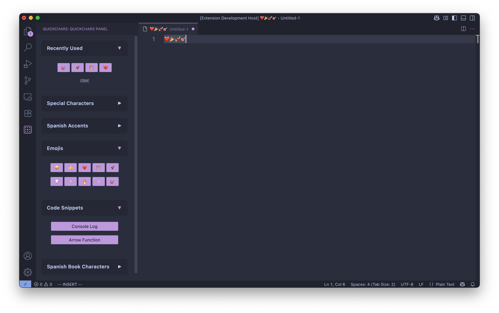
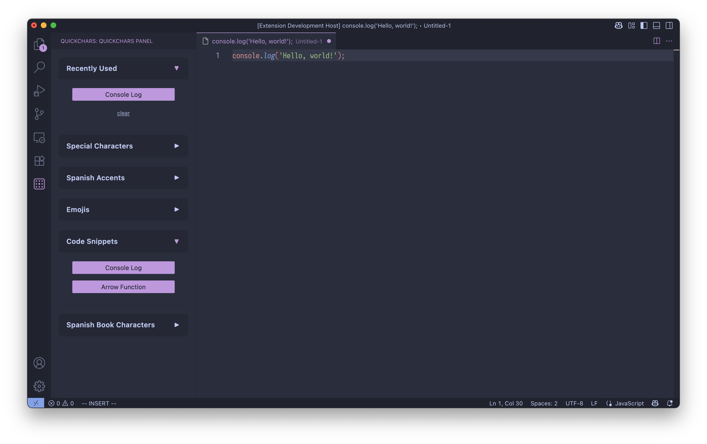
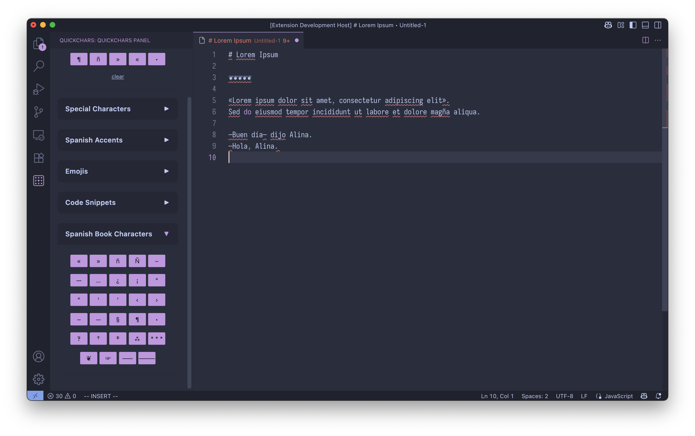
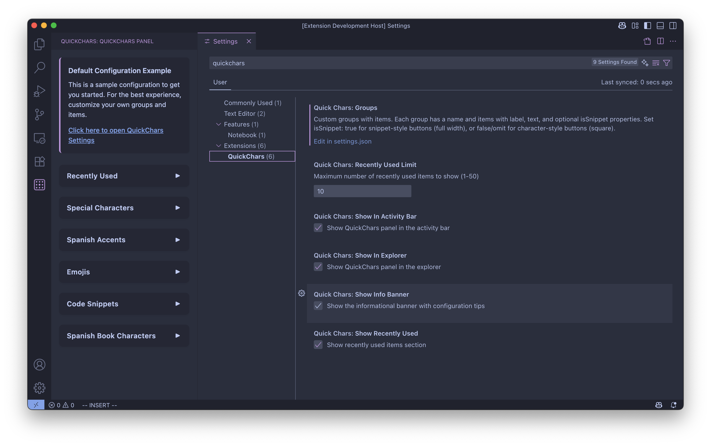

# QuickChars


A Visual Studio Code extension that provides quick access to special characters, symbols, emojis, and code snippets through a convenient sidebar panel.

If you enjoy this extension, you can:

  <a href="https://www.buymeacoffee.com/ottojimb">
    
  </a>

## Screenshots

<details>
<summary>Emojis</summary>

</details>
<details>
<summary>Snippets</summary>

</details>
<details>
<summary>Custom</summary>

</details>
<details>
<summary>Settings</summary>

</details>

## Features

- **Quick Character Insertion**: Insert special characters and symbols with a single click
- **Code Snippets**: Insert predefined code snippets with placeholders and tab stops
- **Search**: Filter every group by label, inserted text or group name
- **Command Palette Access**: Insert any item from the keyboard with `QuickChars: Insert Character or Snippet...`
- **Copy to Clipboard**: Alt+Click an item to copy it instead of inserting it
- **Recently Used**: Your most used items are kept at the top of the panel
- **Collapsible Groups**: Organize items into groups that remember their expanded/collapsed state
- **Dual Panel Support**: Available in both the Activity Bar and the Explorer sidebar
- **Fully Customizable**: Configure your own groups and items through VS Code settings

## Default Groups

QuickChars comes with these pre-configured example groups:

- **Special Characters**: Arrows, copyright, checkmarks, currency symbols, mathematical operators
- **Spanish Accents**: Accented letters and Spanish punctuation (¿, ¡)
- **Emojis**: Common emojis for documentation and comments
- **Code Snippets**: Console.log and arrow function templates

## How to Use

1. **Open the panel**: Look for the QuickChars icon in the Activity Bar or Explorer sidebar
2. **Insert items**: Click any button to insert the character or snippet at the cursor. Focus returns to the editor so you can keep typing
3. **Search**: Type in the search box to filter items. Press `Enter` to insert the first match and `Escape` to clear the search
4. **Copy instead of insert**: Alt+Click a button. If no editor is open, the item is copied to the clipboard automatically
5. **Use the keyboard**: Run `QuickChars: Insert Character or Snippet...` from the Command Palette, or bind it to a shortcut
6. **Hide the info banner**: Uncheck "Show Info Banner" in settings once you're familiar with the extension

## Customization

### Adding Your Own Groups and Items

1. Open VS Code Settings (`Ctrl/Cmd + ,`)
2. Search for "QuickChars"
3. Edit the "Groups" configuration

### Configuration Format

```json
{
  "quickChars.groups": [
    {
      "name": "My Custom Group",
      "items": [
        { "label": "→", "text": "→" },
        { "label": "My Snippet", "text": "console.log('$1');", "isSnippet": true }
      ]
    }
  ]
}
```

### Configuration Example

```json
{
  "quickChars.groups": [
    {
      "name": "Math Symbols",
      "items": [
        { "label": "α", "text": "α" },
        { "label": "π", "text": "π" }
      ]
    },
    {
      "name": "JS Snippets",
      "items": [
        { "label": "Log", "text": "console.log(${1:value});$0", "isSnippet": true }
      ]
    }
  ]
}
```

### Item Properties

- `label`: Text displayed on the button
- `text`: Text to be inserted
- `isSnippet` (optional): Set to `true` to insert the text as a snippet with a full-width button. Without it, the text is inserted literally, so characters such as `$`, `{` or `\` are kept as they are

### Placeholder Support

Placeholders only apply to items with `"isSnippet": true`:

- `$1`, `$2`, etc. for tab stops
- `${1:placeholder}` for default text
- `$0` for the final cursor position

### Keyboard Shortcut

Add this to your `keybindings.json` to open the item picker with a shortcut:

```json
{ "key": "ctrl+alt+i", "command": "quickChars.insertItem" }
```

## Commands

- **QuickChars: Insert Character or Snippet...**: Pick any item from a searchable list and insert it
- **QuickChars: Toggle QuickChars in Activity Bar**: Show/hide the Activity Bar panel
- **QuickChars: Toggle QuickChars in Explorer**: Show/hide the Explorer panel
- **QuickChars: Clear Recently Used Items**: Remove all recently used items

## Tips

- Groups remember their expanded/collapsed state between sessions
- Use `isSnippet: true` for multi-line code templates that need full-width buttons
- Regular characters work best as square buttons without the `isSnippet` property
- You can completely replace the default configuration with your own groups
- The first group is expanded by default, others start collapsed

## Requirements

- Visual Studio Code 1.95.0 or higher (also compatible with Cursor)

## Extension Settings

This extension contributes the following settings:

* `quickChars.groups`: Define your custom groups and items
* `quickChars.showInfoBanner`: Enable/disable the configuration tips banner
* `quickChars.showInActivityBar`: Show/hide QuickChars in the Activity Bar
* `quickChars.showInExplorer`: Show/hide QuickChars in the Explorer
* `quickChars.showRecentlyUsed`: Show/hide the recently used section
* `quickChars.recentlyUsedLimit`: Maximum number of recently used items (1-50)

## License

This extension is provided as-is without warranty. Feel free to modify and distribute according to your needs.
